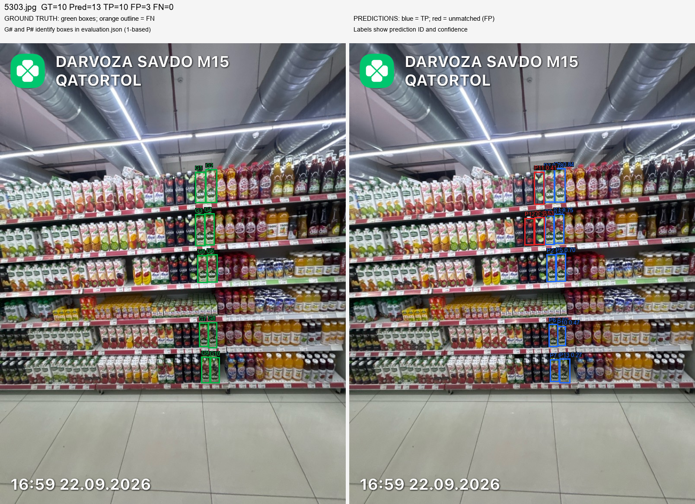
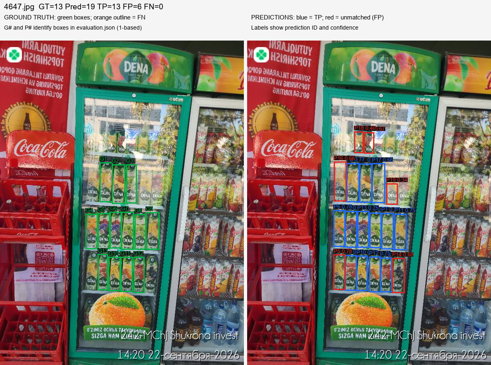
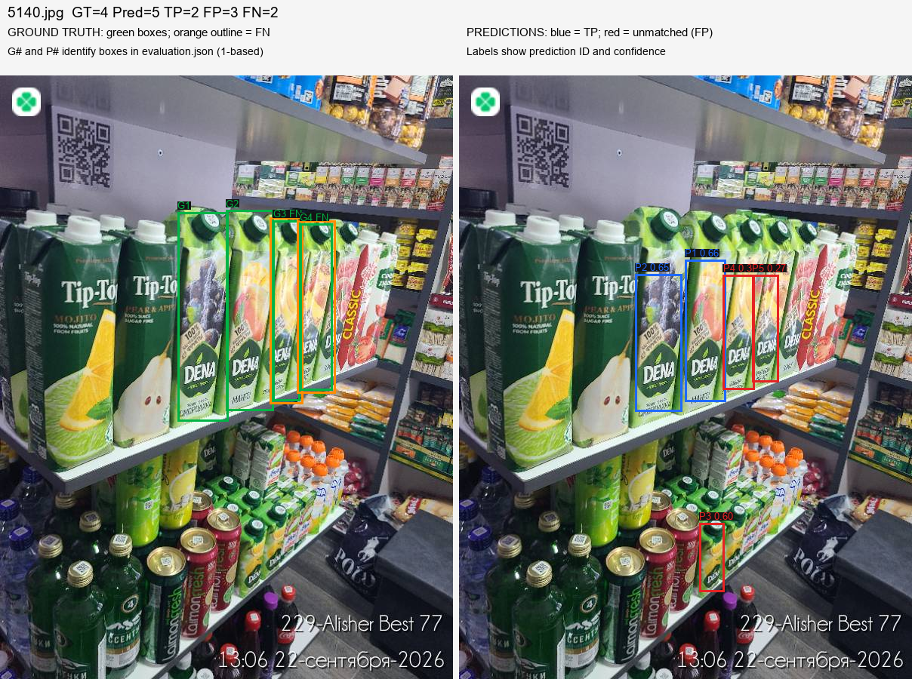
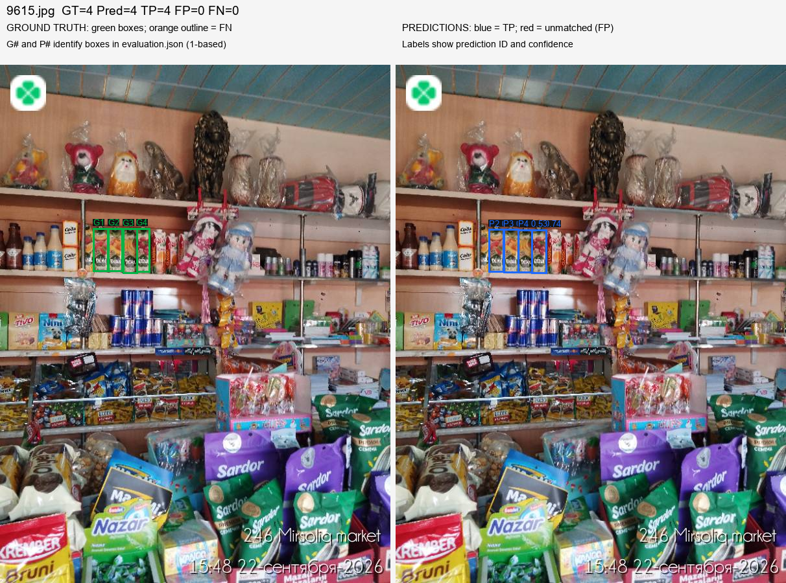
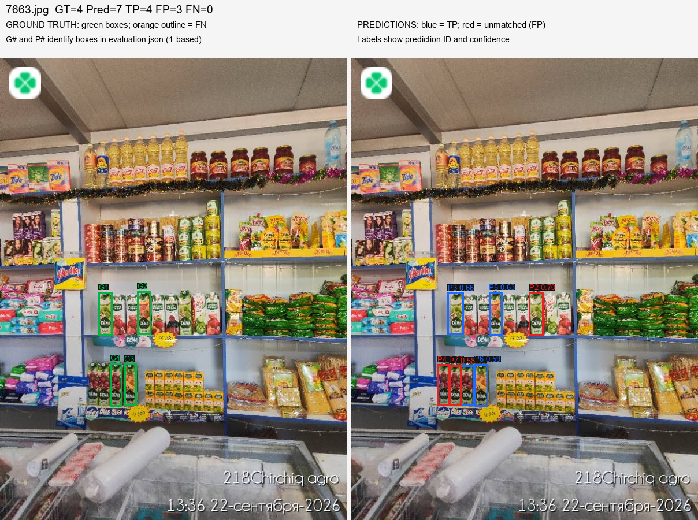

# DENA baseline benchmark evaluation

Model: `E:\Coding\Shelf_recognition\dena_poc\runs\detect\dena_baseline\weights\best.pt`. All 15 test images evaluated.

Baseline inference: confidence **0.25**, NMS IoU **0.45**, image size **1024**, maximum detections **1000**.

A TP requires IoU >= **0.5** with an unused GT box. Predictions are processed in descending confidence order and matched to their highest-IoU unused GT. Duplicates and unmatched predictions are FP; unused GT boxes are FN. All boxes are class 0: DENA. Zero-denominator precision/recall are reported as 0. These fixed-threshold counts differ from AP metrics and the training validator's automatically selected operating point.

## Locked benchmark results

| Image | GT | Pred | TP | FP | FN | Precision | Recall |
| --- | ---: | ---: | ---: | ---: | ---: | ---: | ---: |
| 5303.jpg | 10 | 13 | 10 | 3 | 0 | 76.92% | 100.00% |
| 4647.jpg | 13 | 19 | 13 | 6 | 0 | 68.42% | 100.00% |
| 5140.jpg | 4 | 5 | 2 | 3 | 2 | 40.00% | 50.00% |
| 9615.jpg | 4 | 4 | 4 | 0 | 0 | 100.00% | 100.00% |
| 7663.jpg | 4 | 7 | 4 | 3 | 0 | 57.14% | 100.00% |

## Overall test results

| Image | GT | Pred | TP | FP | FN | Precision | Recall |
| --- | ---: | ---: | ---: | ---: | ---: | ---: | ---: |
| 4647.jpg | 13 | 19 | 13 | 6 | 0 | 68.42% | 100.00% |
| 5140.jpg | 4 | 5 | 2 | 3 | 2 | 40.00% | 50.00% |
| 5303.jpg | 10 | 13 | 10 | 3 | 0 | 76.92% | 100.00% |
| 7663.jpg | 4 | 7 | 4 | 3 | 0 | 57.14% | 100.00% |
| 9615.jpg | 4 | 4 | 4 | 0 | 0 | 100.00% | 100.00% |
| img_070c4b545f60a7ab71179b478103e11558951d7a6602d8b73c80818eaacefde2.jpg | 7 | 13 | 7 | 6 | 0 | 53.85% | 100.00% |
| img_238988a7e101ff51900679fbab92ef5337d044bb4e7388570a439f516fe33ac6.jpg | 0 | 5 | 0 | 5 | 0 | 0.00% | 0.00% |
| img_37bc8c3e4e601afc6bb0fb4c9aff78186b9bcbeec2a91f37bd11ea65314cf6a9.jpg | 3 | 6 | 3 | 3 | 0 | 50.00% | 100.00% |
| img_3852dca8e8ef0c2ef58482e74c033622c850a89941ac8ddb2fad2da9414c3ee9.jpg | 3 | 0 | 0 | 0 | 3 | 0.00% | 0.00% |
| img_7587ab539e83156b7bc7ca01708f00d6d28700fceeea1fd7b0da682a3b9b6d04.jpg | 3 | 4 | 3 | 1 | 0 | 75.00% | 100.00% |
| img_8ac2e71d29020210fdf68e06a9966ea561338bb1bfb49a4a2fd0e6ccc36fb42a.jpg | 3 | 3 | 3 | 0 | 0 | 100.00% | 100.00% |
| img_92c373f58040002f7e2b627a394d7ab97615bf70900af019bb84f75b3c42759c.jpg | 0 | 0 | 0 | 0 | 0 | 0.00% | 0.00% |
| img_c20eff509236c57043ca7098e0792c6f553e85b268c7711e5ae474a5149246cb.jpg | 12 | 21 | 12 | 9 | 0 | 57.14% | 100.00% |
| img_caefddb8eb60ade27165e27c98b8253cd375ce6b78c2f85394033a75ed94c1af.jpg | 1 | 1 | 1 | 0 | 0 | 100.00% | 100.00% |
| img_e0c8c304053978eabf45fbc99383f2c6339c7359b70e497bfc6817b9d365f17d.jpg | 4 | 1 | 1 | 0 | 3 | 100.00% | 25.00% |

All test images (micro): GT=71, predictions=102, TP=63, FP=39, FN=8; precision=61.76%, recall=88.73%, F1=72.83%.

Five benchmarks (micro): GT=35, predictions=48, TP=33, FP=15, FN=2; precision=68.75%, recall=94.29%, F1=79.52%.

## Qualitative failure analysis

### 5303: Small scale / distant shelf

All 10 annotated DENA cartons are recovered (10 TP, 0 FN). Their narrow fronts are roughly 22-27 original pixels wide, so this benchmark does not demonstrate a small-object recall failure at 1024px. The 3 unmatched predictions P9, P11 and P12 land on adjacent GARDI cartons, whose brand text is visible: these are genuine competing-brand false alarms, with confidences about 0.53, 0.41 and 0.35. At confidence 0.50 only one of these alarms remains, but two real DENA cartons are lost (8 TP, 1 FP, 2 FN). Lowering confidence to 0.10 preserves recall and increases FP from 3 to 9 at NMS IoU 0.45. SAHI is not justified by this locked case; hard-negative examples of GARDI and careful operating-point selection address the observed failure more directly.

### 4647: Refrigerator glare

All 13 annotated packages are recovered despite refrigerator reflections (13 TP, 0 FN). The 6 unmatched predictions are P5, P14, P15, P16, P18 and P19. They appear to cover additional DENA cartons outside the annotated subset: two fronts on the top visible row, a left-side carton in the next row, a partly reflected right-hand front, and two outer cartons on the lower row. This is a probable annotation-coverage problem that requires human adjudication, including whether a reflected or partly obscured front represents a separate physical package. It is not evidence of six wrong-brand hallucinations. No measured GT dropout supports adding CLAHE on this case. Image-level glare causation would require a controlled preprocessing comparison with complete annotations.

### 5140: Angled display / occlusion

The default counts are 2 TP, 3 FP and 2 FN. G3 and G4 have nearby predicted DENA fronts P4 and P5, but those predictions omit upper portions/caps and shift horizontally: their best GT IoUs are 0.435 and 0.345, below the required 0.50. These are bounding-box localization failures on an oblique display, rather than complete absence of a detection. Their shorter sides at inference scale are about 46px and 55px, so they are not the smallest boxes in this evaluation. P3 is an additional visible DENA carton on the lower shelf without a corresponding GT box. Further visible upper/lower packages also warrant a completeness audit. Neither lowering confidence to 0.10 nor varying NMS IoU from 0.30 to 0.60 recovers G3/G4. Raising confidence to 0.50 removes their inaccurate predictions and leaves both FNs. Standard threshold tuning alone is insufficient; prioritize complete, consistent whole-package boxes and additional oblique/occluded training examples, then assess rotation/perspective augmentation on validation data.

- Miss G3: shorter side at inference scale 45.9px; maximum baseline prediction IoU 0.435.
- Miss G4: shorter side at inference scale 54.7px; maximum baseline prediction IoU 0.345.

### 9615: Clutter / toys

All 4 annotated juice cartons are recovered with no unmatched predictions (4 TP, 0 FP, 0 FN). The detector places no boxes on the toys, figurines, hanging dolls or snack clutter in this image. The same counts hold throughout the tested confidence range 0.10-0.50 and NMS IoU range 0.30-0.60. This single case supports robustness to its particular clutter, not a general guarantee for all toy displays.

### 7663: Mixed competitor shelf

All 4 annotated cartons are recovered (4 TP, 0 FN). The 3 unmatched predictions P2, P4 and P7 land on visible DENA fronts omitted from GT: one additional middle-row green carton and two left-hand cartons on the lower row. Their confidences are approximately 0.70, 0.66 and 0.58, and all three persist at confidence 0.50. They appear to be real unannotated packages, not detections on competing cartons, noodles, jars or the freezer. Human review should resolve annotation completeness before interpreting the formal 57.14% precision as competitor hallucination or choosing a stricter threshold.

## Diagnostic threshold sweep on test

Exploratory only: do not select deployment thresholds or claim fresh held-out performance from this sweep. Confirm any threshold choice on validation data. The default baseline table above remains unchanged.

| Confidence | NMS IoU | TP | FP | FN | Precision | Recall | F1 |
| ---: | ---: | ---: | ---: | ---: | ---: | ---: | ---: |
| 0.10 | 0.30 | 63 | 58 | 8 | 52.07% | 88.73% | 65.62% |
| 0.10 | 0.45 | 63 | 60 | 8 | 51.22% | 88.73% | 64.95% |
| 0.10 | 0.60 | 63 | 65 | 8 | 49.22% | 88.73% | 63.32% |
| 0.25 | 0.30 | 63 | 39 | 8 | 61.76% | 88.73% | 72.83% |
| 0.25 | 0.45 | 63 | 39 | 8 | 61.76% | 88.73% | 72.83% |
| 0.25 | 0.60 | 63 | 40 | 8 | 61.17% | 88.73% | 72.41% |
| 0.50 | 0.30 | 59 | 21 | 12 | 73.75% | 83.10% | 78.15% |
| 0.50 | 0.45 | 59 | 21 | 12 | 73.75% | 83.10% | 78.15% |
| 0.50 | 0.60 | 59 | 21 | 12 | 73.75% | 83.10% | 78.15% |

## Recommendation

Do not add SAHI or CLAHE to the baseline yet. The locked distant-shelf and refrigerator-glare cases both have 100% recall against their supplied GT; neither demonstrates the target dropout that would justify these interventions. Audit annotation completeness and GT-negative decisions first, keeping the current locked labels and results unchanged until that review is explicitly resolved. Then improve angle/occlusion and horizontally laid-carton training coverage and whole-package localization. Threshold tuning can trade false alarms for recall but is not sufficient alone: at NMS IoU 0.45, confidence 0.50 raises measured all-test precision from 61.76% to 73.75%, while recall drops from 88.73% to 83.10%; confidence 0.10 recovers no additional GT and adds 21 FP. Changing NMS IoU to 0.30 gives identical baseline counts; 0.60 adds one FP and recovers no misses. Keep 0.25/0.45 as the reported baseline and choose any deployment operating point using the validation split. After label auditing, a limited slicing experiment on the separate narrow, oblique-row failure may be worth measuring; improvement is not established by this evaluation.

Additional test-set misses: `img_3852dca8e8ef0c2ef58482e74c033622c850a89941ac8ddb2fad2da9414c3ee9.jpg` contributes 3 FN on horizontally laid/occluded DENA cartons in open shipping cases. `img_e0c8c304053978eabf45fbc99383f2c6339c7359b70e497bfc6817b9d365f17d.jpg` contributes 3 FN on a narrow, distant oblique row, with only 1 of its 4 annotated fronts detected. Together with the two localization FNs in 5140, these account for all 8 formal FNs. None is recovered at confidence 0.10 within the measured NMS range. The oblique-row image visibly contains further unannotated DENA packages, so its object-size analysis is limited to the supplied four GT boxes.

Annotation audit flag: `img_238988a7e101ff51900679fbab92ef5337d044bb4e7388570a439f516fe33ac6.jpg` is currently reviewed_negative (GT=0), yet its 5 predictions overlap shelf fronts visibly bearing DENA branding. This deserves human review. The evaluation preserves the user's existing negative decision and counts all five as FP; it does not automatically reclassify or relabel the image.

Across the five benchmarks, at least 10 of the 15 formal FPs appear to be annotation/localization issues: the six unannotated-looking detections in 4647, the three clearly unannotated DENA fronts in 7663, and the unannotated lower-shelf DENA carton in 5140. The remaining five comprise three GARDI false alarms in 5303 and two failed-IoU localization detections in 5140. These are qualitative audit categories, not corrected ground-truth metrics. Structural dataset validation confirms files and geometry, but cannot certify semantic label completeness. Both this evaluation and the earlier training test metrics are conditional on the supplied annotations.

Only five locked benchmark photographs and 15 total test images were examined. SAHI and CLAHE were not run; claims about their improvement would require paired experiments. The confidence/NMS sweep is an exploratory diagnostic on the already-inspected test set, not an independently validated deployment-threshold selection.

## Reproducibility and artifacts

- Weights SHA256: `a7dcd88dd5c5f56e19e3e2fec584cc088d04eb0bfde8205f64dd4fc4b4ce9225`
- Manifest SHA256: `cdf9088dc4de58d3f6d166c1006f5f4258bec0702d1ee1b2b8a18a6979546ced`
- Test annotations SHA256: `67289483ae40656db0cf236029a1b8c596eb42d0d4497df7d9ceb794115d3137`
- Evaluation duration: 7.43 seconds.
- `evaluation.json`: exact GT/prediction boxes, matches, FN/FP indices, size diagnostics and per-image sweep results.
- `metrics.csv`: baseline counts and precision/recall for every test image.
- `predictions/<image-stem>.json`: DENA detections in absolute xyxy pixel coordinates.
- Comparison PNGs: green GT on the left, missed GT outlined orange; matched predictions blue and unmatched predictions red on the right.
- Source images, labels, manifests and model weights are never modified by evaluation.

Visual review provenance: Codex visual inspection of the five benchmark comparisons, all FN images, and the GT-empty test image with predictions.
